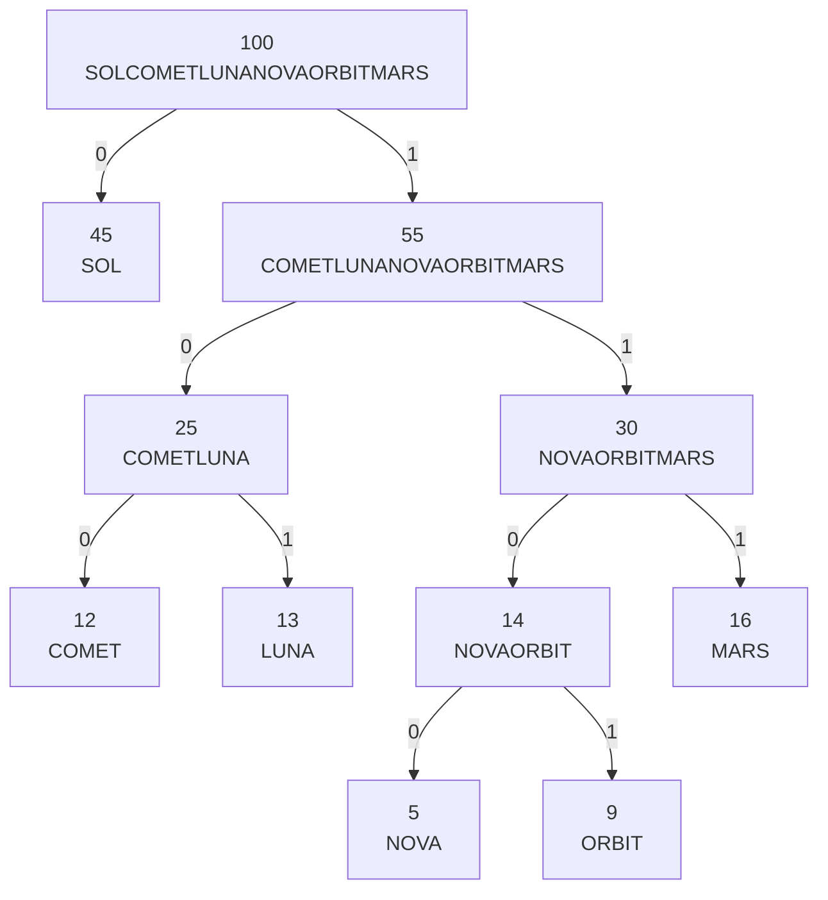

# Satellite Network

  [](https://github.com/andreipopa05/satellite-network/actions/workflows/ci.yml)

A command-line tool written in C that builds a network of satellites as a binary tree, using a **Min-Heap** to decide how satellites are linked. The more often a satellite reports, the closer to the root it ends up.

Besides building the network, it can decode and encode binary routing messages, find the closest common parent of a set of faulty satellites, and extend the network with multi-way trees to compute distances between any two satellites.

## How the network is built

Every satellite has a name and a reporting frequency. The network is built like this:

1. Take the two satellites with the lowest frequencies from the Min-Heap (ties are broken alphabetically).
2. Create a **link satellite** as their parent. Its frequency is the sum of the two, and its name is the concatenation of its children's names. The satellite with the lower frequency is the left child.
3. Insert the link satellite back into the heap and repeat until a single tree is left.

For the satellites in `examples/` (`NOVA 5`, `ORBIT 9`, `COMET 12`, `LUNA 13`, `MARS 16`, `SOL 45`) the result is:



Walking from the root, `0` means "go left" and `1` means "go right". The path to a satellite is its code (for example `SOL` = `0`, `COMET` = `100`, `NOVA` = `1100`).

## Usage

```bash
make build
./satellite -c1 input.txt output.txt
```

| Option | What it does |
|---|---|
| `-c1` | Builds the network and prints it level by level |
| `-c2` | Decodes binary codes into satellite names |
| `-c3` | Encodes satellite names into one binary code |
| `-c4` | Finds the closest common parent of a set of satellites |
| `-c5` | Attaches multi-way trees to the network and computes the distance between two satellites |

Every input starts with the satellite list:

```text
6
5 NOVA
9 ORBIT
12 COMET
13 LUNA
16 MARS
45 SOL
```

(the number of satellites, then one `frequency name` pair per line). The examples below show only what follows it.

### `-c1`: build and print

No extra input. Output, one line per level:

```text
100-SOLCOMETLUNANOVAORBITMARS
45-SOL 55-COMETLUNANOVAORBITMARS
25-COMETLUNA 30-NOVAORBITMARS
12-COMET 13-LUNA 14-NOVAORBIT 16-MARS
5-NOVA 9-ORBIT
```

### `-c2`: decode

Extra input: the number of codes, then one binary code per line (up to 1000 characters each).

```text
2
01001100
11111011010
```

Output, the satellites encoded in each code:

```text
SOL COMET NOVA
MARS ORBIT LUNA SOL
```

### `-c3`: encode

Extra input: the number of names, then one name per line.

```text
4
LUNA
SOL
NOVA
MARS
```

Output, the codes in the same order:

```text
10101100111
```

### `-c4`: closest common parent

Extra input: the number of faulty satellites, then their names.

```text
3
ORBIT
COMET
NOVA
```

Output, the name of the lowest satellite that has all of them below it:

```text
COMETLUNANOVAORBITMARS
```

### `-c5`: multi-way trees and distances

Any satellite of the main tree (except the root) can have a multi-way tree attached to it. Each tree is given level by level:

```text
T                      number of trees to attach
attach_name            satellite of the main tree the tree hangs from
frequency root_name    root of the multi-way tree
P                      number of nodes that have children
parent_name            \
C                       } repeated P times, parents listed level by level
frequency name (x C)   /
name1 name2            the two nodes whose distance is requested
```

Example:

```text
2
NOVA
7 AX1
2
AX1
3
4 AY1
9 AY2
2 AY3
AY2
1
6 AZ1
SOL
3 BX1
1
BX1
2
8 BY1
1 BY2
AZ1 BY2
```

Output, the number of links between the two nodes (`AZ1`, `AY2`, `AX1`, `NOVA`, then 5 links through the main tree down to `SOL`, then `BX1` and `BY2`):

```text
10
```

The two nodes can be anywhere: in the main tree, in the same multi-way tree, or in different ones.

## Implementation notes

- **Min-Heap:** array-based, with a comparison function (frequency, then name). Building the network takes O(n log n).
- **Nodes:** a single node type is used for both trees. The main tree uses `left` and `right`. For the multi-way trees the same nodes use `first_child` and `next_sibling`, and every node keeps a `parent` pointer. For a main-tree node, `first_child` is the link to the root of the attached multi-way tree.
- **Encoding and decoding:** satellites are the leaves of the tree, so a satellite is found by an exact search for the leaf (not by looking at the link nodes' concatenated names, which could confuse names like `R1` and `R11`).
- **Distance:** both nodes climb through their `parent` pointers until they meet, counting the links.

## Tests

```bash
make test
```

Runs every example in `examples/` and compares the output with `expected.txt`. The name of each example folder starts with the option it uses (`c1_...` runs `-c1`), so a new example is just a new folder with `input.txt` and `expected.txt`.

## Memory safety

The program frees all of its memory. It was checked with AddressSanitizer and Valgrind on a large set of inputs (including networks with hundreds of satellites), with no leaks or memory errors reported.

## Project structure

```text
satellite-network/
├── include/
│   └── functions.h      data structures and function declarations
├── src/
│   ├── main.c           input parsing and option dispatch
│   └── operations.c     heap, tree, encoding/decoding and distance operations
├── examples/            one example per option, with expected output
├── Makefile
└── README.md
```

## Limitations

- A satellite name has at most 15 characters and no spaces.
- Modes `-c3` and `-c4` accept at most 256 names per query.
- Input files must use Unix line endings (LF).
- In `-c5`, if a name appears more than once, the first match is used. If a requested node does not exist, nothing is written.